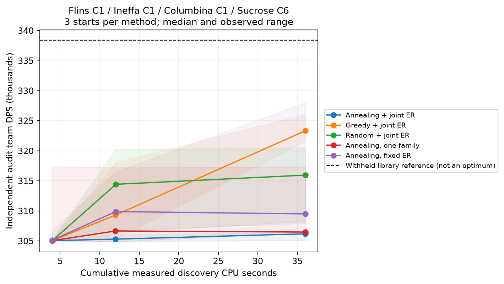

# Flins recovery pilot, 2026-11-05

The native optimizer is implemented and the declared development party runs
correctly. A discovered program improves the original cycle by **7.58%** at
unchanged equipment and artifact allocation. The proposed annealing/joint-ER
combination is **not validated for batch expansion**: greedy search was more
consistent at this budget, the withheld library cycle is still stronger, and
the wider pilot suite remains incomplete.

## Frozen conditions and confirmed result

Flins C1 / Ineffa C1 / Columbina C1 / Sucrose C6, level 90/90, base talents
10/10/10. Five-star signatures R1, Wandering Evenstar R5 on Sucrose. Main stats
are ATK/ATK/CD, ATK/ATK/CD, HP/HP/CD and EM/EM/EM. The manifest records each
physical artifact piece, nine maximum-tier rolls, four distinct substats and
a frozen CV ceiling of 38.9. Standard builds are experimental conditions, not
player builds. The selected program's allocation exactly matches the frozen
standard allocation; this improvement does not come from extra artifact rolls.

All fights last 450 seconds; DPS excludes the first 150 seconds. One level-100
target, 10% resistance, radius 2, position (0, 2.4), periodic energy every
480–720 frames, amount 1, swap delay 12. Starting energy follows the site's
duration-mode default. The engine is pinned at
`1ba0af119e0477d6f44ee966a78fa06d84d2c5de`.

| Program | Independent native team DPS | Standard error | Iterations |
|---|---:|---:|---:|
| Original library cycle | 305,052.17 | 46.31 | 2,048 |
| Discovered program | **328,162.63** | 49.32 | 2,048 |
| Withheld higher-constellation library cycle | 338,426.03 | 44.28 | 2,048 |

The original and discovered program use the same fresh confirmation seed
namespace; the reference uses another independent namespace. The discovered
program is **3.03% below the withheld reference**, which is not an optimum.
Its source is [discovered.gcsl](discovered.gcsl); piece-level provenance is
[discovered.json](discovered.json). The source baseline and known alternative
are also retained. Programs can contain redundant actions; no manual cleanup
or hand-written high-DPS replacement was substituted for the measured output.

On gcsim (`cenoda/gcsim@eb218847f82b`), 2,048 iterations each:

| Program | Native vs gcsim team difference | Major-character accuracy |
|---|---:|---|
| Original cycle | −0.029% | Every contributor above 10% within 1% |
| Discovered program | +0.033% | Every contributor above 10% within 1% |
| Withheld reference | −0.026% | Every contributor above 10% within 1% |

Raw means, standard errors, per-ability diagnostics and CPU accounting are in
`reference-baseline/`, `reference-selected/` and `reference-withheld/`.
The gcsim Spearstorm hit count over the scored 300 seconds rises from 34 to
about 56. This is observed behavior, not an inferred universal combo rule.

## Repeated starts and equal CPU budgets

Each variant used starts 11, 37 and 91, with cumulative discovery caps of
4, 12 and 36 CPU-seconds. Every point freezes the shortlist before 128-fight
audits on separate seeds. The table reports the median **pre-audit selected**
candidate's audited DPS, not the most favorable candidate chosen after auditing.
All individual starts and their measured CPU are retained in
[experiments.json](experiments.json).

| Variant | 4 CPU-s | 12 CPU-s | 36 CPU-s |
|---|---:|---:|---:|
| Annealing, joint ER | 305,064 | 305,314 | 306,198 |
| Greedy, joint ER | 305,064 | 309,309 | **323,340** |
| Random, joint ER | 305,064 | 314,435 | 315,961 |
| Annealing, one family | 305,064 | 306,670 | 306,488 |
| Annealing, fixed ER | 305,149 | 309,895 | 309,507 |



Bands show the observed range across three starts, not confidence intervals.
The highest individual confirmed result comes from the fixed-ER annealing
experiment; its median is substantially lower. Neither that best run nor greedy's
median proves convergence. Family competition and joint ER have not demonstrated
a benefit on this energy-rich development case at these budgets.

The first local-only comparison started from a generated field window while
the full method included the actual baseline. That was a confounded comparison.
Its three runs are excluded, kept in [excluded-local-starts.json](excluded-local-starts.json)
and charged in [accounting.json](accounting.json). The corrected local-only
experiments start from exactly the same baseline; their first decision keys are
checked by `scripts/check_run.py`.

The unmodified C0 library program is an allowed seed. The complete higher-
constellation alternative was first read after generator commit `b9c315d`.
It did not enter seed construction, mutation dictionaries or tuning. Small
ability blocks and the original baseline overlap are disclosed in the protocol.
This party is a development case, not a blind test of generalization.

## Correctness and transfer evidence

- Four Rust tests pass, including physical allocation invariants, mutated GCSL
  parsing, preservation of source guards and exact same-seed equivalence after
  lexical normalization. Strict Clippy and formatting checks pass.
- All 15 valid runs pass the journal checker. There are 3,782 completed/failed
  decision events and 1,138 accepted events. Every acceptance uses an actual
  common completed block of at least 16 full fights, with the logged delta and
  original acceptance threshold. Failed attempts consume CPU; 177 failed sample
  records remain visible rather than silently disappearing.
- Peak archive comparisons use fresh common 32-fight blocks. No 2/4/8-fight
  state replacement or heuristic low-DPS rejection is enabled. The archive
  includes the baseline and stays within six programs.
- Sucrose's four-weapon preparation used equal eight-CPU-second searches and
  independent audits; Evenstar R5 was the best tested conditional choice.
  [preparation.json](preparation.json) preserves all outcomes and source hashes.
- The eight-program finite grammar is exhaustively evaluated on 32 fixed full
  fights. Table-replay searches recover its sample maximum in 15/15 starts.
  [enumerated-reference.json](enumerated-reference.json) explicitly labels replay;
  this is not production-chain recovery, a CPU benchmark or an unrestricted
  optimality bound. Production-chain restricted recovery remains to be tested.

Selected-program reuse uses the actual target constellation vector, unchanged
equipment and 128 full fights per candidate, at common probe seeds:

| Actual constellations, in party order | Original cycle | Discovered program |
|---|---:|---:|
| C1/C1/C1/C6 | 305,238 | 328,261 |
| C0/C1/C1/C6 | **305,238** | 6,827 |
| C1/C0/C1/C6 | 274,217 | **295,631** |
| C1/C1/C0/C6 | **286,916** | 102,521 |
| C2/C1/C1/C6 | 352,877 | **385,040** |
| C1/C4/C2/C6 | 396,755 | **420,526** |

These are build/seed-specific observations, not general `requires_c1_plus`
inferences. They demonstrate why the baseline and actual-build comparisons must
remain: a legal source winner can collapse on a target. C0 cases received no
search; the probes changed one member at a time. See
[transfer-probes.json](transfer-probes.json) for waits, scoring halves and costs.

## Source versions and machine recovery

The source-only starting point was `6fa5c19`. Initial implementation and weapon
preparation are `d4fa5a7`; the main matrix and selected program use `4e09efb`.
The corrected one-family comparison uses `b9c315d`. The only optimizer behavior
change between the last two commits is the local-only starting program; full
method behavior is unchanged. Reports contain exact implementation and manifest
SHA-256 values. Other repositories' worktrees were not modified.

[recovery.zip](recovery.zip) contains the selected experiment's checkpoint,
evaluation journal, shortlist and report. It retains unfinished proposals,
RNG, temperatures, CPU totals and cached samples. Restore it with its exact
source commit; a different executable fingerprint deliberately refuses it:

```sh
git worktree add ../gso-replay 4e09efb
unzip reports/pilot-2026-11-05/recovery.zip -d ../gso-replay/runs/restored
cd ../gso-replay
cargo build --release --locked
./target/release/gso search --manifest data/flins-c1/standard.json \
  --seconds 72 --seed 11 --algorithm anneal --fixed-er \
  --out runs/restored --audit 128
```

Use a fresh run directory when changing source, manifest or algorithm flags.
Discovery caps are cumulative; audits have separate accounting and fresh seed
namespaces at each budget. A clean isolated rebuild from the archived source resumed 279 decisions to 284, preserved prior decisions (apart from negligible JSON float reformatting in logs) and passed the common-block checker. See [recovery-verification.json](recovery-verification.json).

## Expansion decision

**Pilot-only; do not start the full batch.** This implementation establishes
reproducible positive program-only gain and correct simulation on the declared
party. It does not establish the original annealing proposal's superiority or
general transfer quality. The next pilot should prioritize the better-performing
greedy control, inspect why joint ER/family competition spend depth inefficiently,
and test new cases before changing the generator.

Still missing from the broader plan: other parties and role-changing controls,
deliberately energy-starved cases, import-only versus target refinement at equal
cost, production-chain finite-domain recovery, actual-player-gear residual loss,
the C0 Furina/C6 Skirk case and its high-support/C0-dealer counterpart, and VM
throughput/tail measurements. The Flins downgrade observations do not substitute
for those parties. No full profile inventory, serving feature, cloud resources
or claim about the unrestricted optimality gap is delivered by this pilot.
