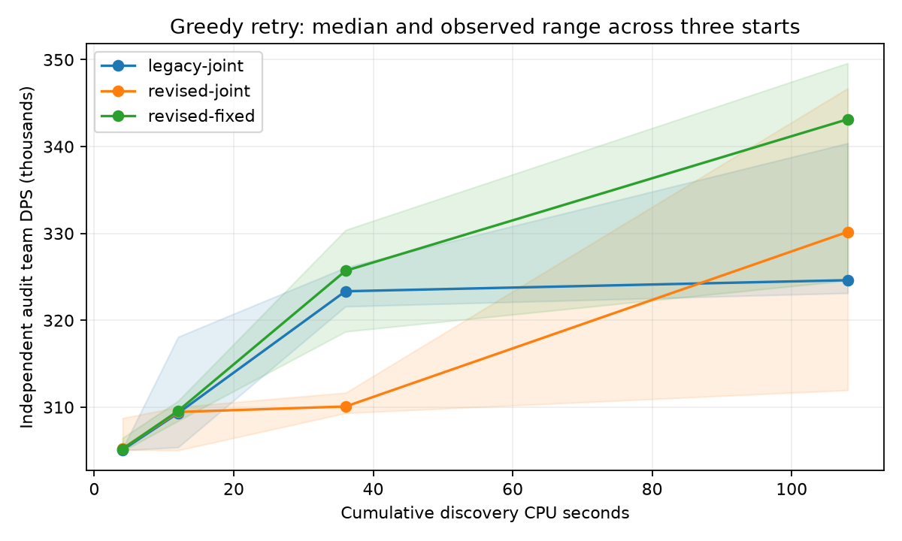

# Greedy pilot retry, 2026-11-05

The retry found a **349,694 team-DPS** cycle at unchanged standard artifacts,
confirmed independently over 2,048 full fights. It exceeds the known library
alternative by **3.30%** under the same conditions. The best variant in this
case was revised greedy **with fixed ER**, not joint ER. Revised joint ER
regressed at the short budget and still has large variation across starts.
This is a useful development-case result, not an unrestricted optimum or
authorization to expand the batch.

The owner required documentation and push first. The [retry protocol](../../docs/pilot-retry.md)
was committed and pushed as **`ba53e63`** before implementation. The tested
implementation was committed and pushed as **`67de69f`** before the matrix.
Search code and inputs stayed frozen throughout measurement. The known library
alternative had already been revealed; this is not a new blind test. It was
never added to initialization, mutation templates or the search objective.

## Independent confirmation

Party: Flins C1 / Ineffa C1 / Columbina C1 / Sucrose C6, the unchanged
`data/flins-c1/standard.json`, original weapons and physical artifact pieces.
The selected candidate's entire allocation equals that original manifest.
Duration is 450 seconds, warmup 150 seconds; target, energy and swap conditions
remain the original pilot's. All confirmation conditions use 2,048 iterations
from fresh common seed 10,000,000,000,000. The simulator remains pinned at
`1ba0af119e0477d6f44ee966a78fa06d84d2c5de`.

| Cycle, identical artifact allocation | Native team DPS | SE |
|---|---:|---:|
| Original baseline | 305,203.02 | 45.62 |
| Known three-burst library alternative | 338,537.13 | 43.62 |
| Selected revised greedy result | **349,694.22** | 42.04 |

The improvement is **44,491.20 DPS (+14.58%)** over baseline and **11,157.09
DPS (+3.30%)** over the known alternative. Paired standard errors are 60.37
and 58.78 DPS respectively. The reference's standard and selected allocations
are identical, so that condition was reused rather than simulated twice.
See [confirmation.json](confirmation.json), [selected.gcsl](selected.gcsl)
and [selected.json](selected.json).

The selection rule was frozen before confirmation: highest final *discovery*
peak estimate among the nine runs, without ranking by audit scores. It selected
`revised-fixed`, seed 91, at 108 cumulative discovery CPU-seconds. The discovery
estimate was 350,658.38; the separate 128-fight audit was 349,607.44. Confirmation
and audit outcomes never feed proposal selection or local improvement.

On pinned gcsim `cenoda/gcsim@eb218847f82b`, the same selected program scores
**349,611.69**, a native difference of **+0.0236%**. Every major contributor
is within 0.06%. Raw native/gcsim outputs, commands and accounting are in
[parity-selected/comparison.json](parity-selected/comparison.json).

The selected Flins main block contains three burst commands. The scored
300-second window contains about 106 Symphony hits versus 100 for the known
alternative, and 52 Spearstorm hits versus 50. The surrounding support sequence
also changed substantially. Hit counts are not per-cycle cast logs. The selected
cycle still has 14.77 seconds of Flins skill-cooldown waits, versus 2.27 in the
reference: minimizing a wait diagnostic alone would not identify the better
cycle. No per-action causal claim or manually cleaned replacement is substituted
for the measured program.

## Equal-budget repeated starts

Each variant starts from the original baseline and four original families,
at seeds 11, 37 and 91. Budgets are cumulative CPU-seconds; every point freezes
its candidate selection before fresh 128-fight audits. Values below are medians
of the **pre-audit selected** candidate, not audit-selected winners.

| Variant | 4 CPU-s | 12 CPU-s | 36 CPU-s | 108 CPU-s |
|---|---:|---:|---:|---:|
| Legacy greedy, joint ER | 305,064 | 309,309 | 323,340 | 324,617 |
| Revised greedy, joint ER | 305,252 | 309,447 | 310,080 | 330,176 |
| Revised greedy, fixed ER | 305,178 | 309,568 | 325,704 | **343,136** |

At 108 CPU-seconds the three outcomes are:

| Variant | Seed 11 | Seed 37 | Seed 91 |
|---|---:|---:|---:|
| Legacy joint ER | 323,137 | 340,389 | 324,617 |
| Revised joint ER | 346,705 | 311,961 | 330,176 |
| Revised fixed ER | 343,136 | 324,579 | 349,607 |



Bands show observed ranges across three starts, not confidence intervals.
All 36 budget-point results, actual CPU and baseline comparisons are retained
in [experiments.json](experiments.json); numeric curves are also CSV/JSON.

The revised bundle helps at the larger budget, especially with fixed ER in this
energy-rich case. Joint ER is not the best configuration here, and its revised
36-second median is substantially worse than legacy. More budget also helps
legacy: one of its 108-second starts exceeds the known alternative. These
findings separate a budget effect from the revised bundle's observed effect;
three starts do not establish universal superiority or convergence. Neighborhood
and polish changes were bundled, so their individual contributions are not
isolated by this matrix.

The original baseline remains within every bounded shortlist. A few short-budget
pre-audit selections have small negative paired audit differences (up to 141
DPS), within sampling noise. Keeping the baseline is necessary; this prototype
does not establish a per-player no-regression guarantee or serving integration.

## Implementation and provenance

`--revised` adds general action-list deletion, whole character-statement
deletion, bounded normal-count changes, relocation and duplication. These
operators apply across characters and preserve control flow and ownership.
They are mixed with the unchanged legacy proposal path; no revealed combo was
inserted. Exact mutation no-ops are logged without simulation, while each
family's initial evaluation remains a real evaluation.

The last quarter of each requested cumulative cap is a bounded deterministic
neighborhood of the current search-selected peak. Joint mode interleaves legal
ER/useful-token exchanges. The anchor, cursor and unfinished proposal persist.
Neighborhood construction, repair attempts, failures and comparisons all count
toward discovery CPU. A resumed larger cap can return to discovery. The observed
maximum last-operation overrun was 0.148 CPU-seconds.

Revised ER repair checks actual `insufficient_energy` waits. The legacy control
retains its original behavior, which could treat cooldown/swap waits as reasons
to add ER. Correcting this condition does not by itself prove joint-ER benefit.
JSON `float_roundtrip` is enabled and the Cargo configuration joins experiment
identity, preserving candidate keys and numeric logs exactly across checkpoints.

Every proposal records its operator, phase, reference key, repair state and full
candidate in `proposals.jsonl`. Events distinguish completed decisions, exact
no-ops, failures and unresolved work; pending work remains in checkpoints.
[operators.json](operators.json) summarizes the evidence. This allows inspection
of which neighbors were proposed and rejected; unproposed neighbors have no
measured fitness and are not presumed worse.

## Verification and recovery

- Seven Rust tests pass, including generic neighborhoods, physical allocations,
  full-fight reduction and exact pending-polish/RNG/candidate-key round trips.
  Formatting and strict Clippy pass.
- All nine matrix runs pass the journal checker: **6,114** completed common
  decision blocks and **926** accepted decision events. Ordinary decisions and
  polish comparisons use at least 16 complete common fights; failures and
  no-ops cannot install chain states. There are **108 failed fight records**,
  retained and charged.
- Independent reconstruction verifies **210 peak changes** through **446**
  completed common 32-fight promotion blocks. Six incomplete/unresolved
  promotions do not alter the reconstructed peak. All reconstructed final
  peaks match the saved search selections. See [peak-checks.json](peak-checks.json).
- The real production search, evaluator, cache and checkpoint path recovers
  the independently enumerated eight-program sample maximum in **5/5 starts**,
  with 192–240 production decisions per start at four CPU-seconds. Search reads
  no ranking table. Decision and promotion blocks use the declared fixed
  32-fight objective. [production-recovery.json](production-recovery.json)
  retains enumeration, actual runs and invariant checks; this does not bound
  any unrestricted optimum.
- A copied unfinished polish run resumes **41 to 56 decisions**, retaining
  every prior event exactly, advancing RNG and continuing its cursor from
  **0 to 15** at the same anchor. [smoke-recovery.json](smoke-recovery.json)
  records the actual pending operator. This is saved-checkpoint recovery;
  arbitrary hard-kill/truncated-journal recovery is not claimed.

An earlier initialization smoke run revealed that exact no-op suppression must
exclude initial family scoring. It was corrected before implementation freeze;
the discarded attempt and its costs remain in [discarded-smoke.json](discarded-smoke.json).
Bounded smoke extensions were used to stop inside a proposal rather than depend
on a wall-time kill.

[all-runs.zip](all-runs.zip) preserves all nine final checkpoints, complete
evaluation/proposal journals, shortlists and all four raw budget reports,
including failed attempts. [recovery.zip](recovery.zip) is the selected run alone.
Both archives passed CRC checks; SHA-256 values are in
[archive-checks.json](archive-checks.json).

Restore the selected run with the exact source:

```sh
git worktree add ../gso-retry-replay 67de69f
unzip reports/pilot-retry-2026-11-05/recovery.zip -d ../gso-retry-replay/runs/restored
cd ../gso-retry-replay
cargo build --release --locked
./target/release/gso search --manifest data/flins-c1/standard.json \
  --algorithm greedy --revised --fixed-er --seed 91 --seconds 216 \
  --out runs/restored --audit 128
```

The example above explains continuation; the published benchmark stops at 108
CPU-seconds. Full retry reproduction uses `scripts/retry_pilot.py matrix` and
`restricted`, followed by `scripts/report_retry.py`, `scripts/confirm_retry.py`
and the journal/peak checkers. Reporting and confirmation scripts are separate
from discovery. Use fresh run directories for changed experiment identities.

## Costs and remaining work

Measured discovery CPU is **972.39 seconds** for the nine matrix runs, with
**152.94 seconds** of separate audits. Restricted recovery uses 20.09 seconds,
its audits 1.98 seconds and enumeration 1.04 seconds. Fresh confirmation plus
selected gcsim parity uses 92.59 seconds. Smoke and discarded attempts are also
recorded in [accounting.json](accounting.json). Smoke audit accounting is the
complete journal's worker CPU; its parent audit overhead is excluded. Build,
orchestration, reporting and other setup overhead are not included in these
process sums. No VM throughput or cloud-cost estimate is inferred.

The next evaluation should preserve legacy as a short-budget control and test
the revised bundle on a new blind case before claiming general benefit. Joint
ER allocation efficiency and starting-point sensitivity remain unresolved.
Other-party, energy-starved, actual-player-gear and mixed-C0 validation from the
broader plan remain incomplete. No full batch, cloud resources, serving feature
or unrestricted optimality claim is delivered by this retry.
